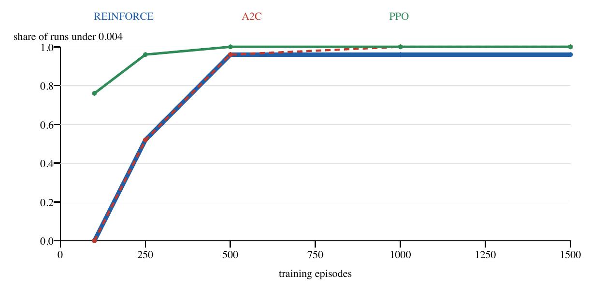
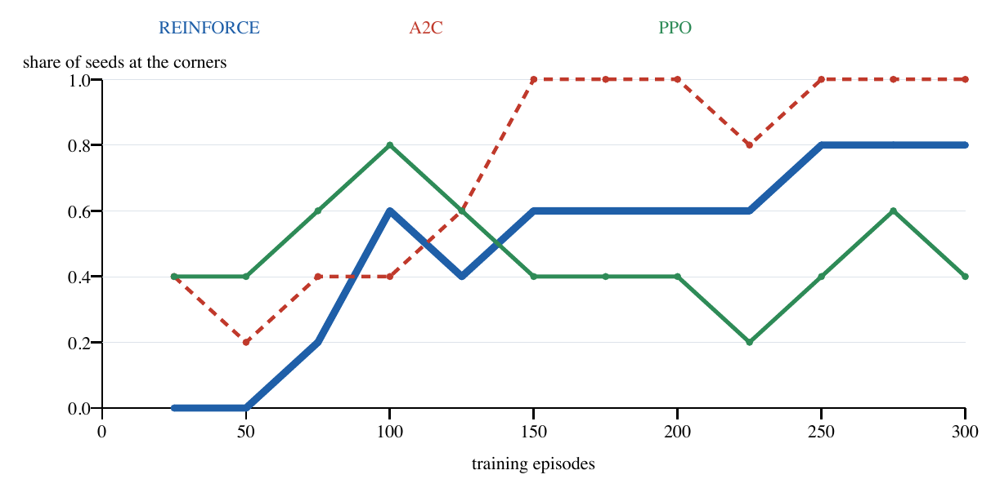

# Dog Game

[](https://github.com/Charith-Reddy-Pareddy/dog-game/actions/workflows/tests.yml)

**Live demo:** https://charith-reddy-pareddy.github.io/dog-game/
**Research report:** [RESEARCH_REPORT.md](RESEARCH_REPORT.md) ([PDF](research_report.pdf), built from it)
**Walking-game report:** [WALKING_GAME_REPORT.md](WALKING_GAME_REPORT.md) ([PDF](docs/walking_game_report.pdf)), policy gradient on the angle-radius game
**Poster:** [docs/poster.pdf](docs/poster.pdf) (48 x 36 in, built from the results), abstract in [POSTER_ABSTRACT.md](POSTER_ABSTRACT.md)
**Inertia proofs:** [docs/INERTIA_PROOFS.md](docs/INERTIA_PROOFS.md) ([PDF](docs/INERTIA_PROOFS.pdf)), the two propositions on feedback equilibria with dog inertia
**Working paper (draft):** [docs/WORKING_PAPER.md](docs/WORKING_PAPER.md) ([PDF](docs/WORKING_PAPER.pdf)), generated by `python3 -m doggame.working_paper`
**Research questions:** [RESEARCH_QUESTIONS.md](RESEARCH_QUESTIONS.md), with the status of each
**Results PDF:** [dog_game_results.pdf](dog_game_results.pdf) (convergence over seeds, the walking game and its paths)
**Professor-facing update:** [PG_RESEARCH_UPDATE.md](PG_RESEARCH_UPDATE.md) ([PDF](docs/PG_RESEARCH_UPDATE.pdf))
**Assumptions:** [ASSUMPTIONS.md](ASSUMPTIONS.md) ([PDF](docs/ASSUMPTIONS.pdf))
**License:** [MIT](LICENSE)

A two-player, general-sum game: a red house and a blue house each want a
shared "dog" to end up as close as possible to their own doorstep. Each
player picks a point in a bounded domain every round, and the dog moves to a
weighted average of the two points. Because the domain is bounded, players
are pushed to exaggerate their pick toward the edge to counteract the other
player's pull, the same dynamic as two influencers staking out opinions further
from their true position to drag a shared audience toward them (the "Battling
Influencers Game").

This repository studies how well learning methods solve it. It has two kinds of
solver, an analytical equilibrium to check both against, a live simulator, and
a set of saved experiments that answer research questions:

- **Policy gradient:** self-play with REINFORCE, A2C and PPO, over three network
  layouts (separate, shared, partly shared). The original dog game now also has
  an exact-support polar action policy (absolute point from the square center),
  alongside the clipped Gaussian and a bounded Cartesian Beta control.
- **Nash-Q on a grid:** a deep-Q style method whose Bellman targets need a stage-game
  equilibrium, solved approximately (fictitious play) or exactly (Lemke-Howson).
- **Verification:** exploitability and an indifference check, so "did it converge?"
  has a number for an answer.

## The game

Two houses sit at fixed points `house_red` and `house_blue` in a bounded, convex
domain (a unit square by default). Each round, both players pick a point
`a_red`, `a_blue` in that domain, and the dog moves to:

```
dog = w * a_red + (1 - w) * a_blue
```

Each player is rewarded by `-||dog - house||^2`, with discount 0.9. Because the
domain is bounded, a player who wants the dog exactly on their house has to
overshoot their own pick to counteract the other player's pull.

Two variants are included:

- **Dog inertia.** `make_inertial_transition(w0)` gives the dog momentum:
  `dog' = w0 * dog + (1 - w0) * (w * a_red + (1 - w) * a_blue)`. With the actions held
  fixed the dog reaches the same steady state, just more slowly.
- **The walking game (the angle-radius version).** Instead of jumping to any point,
  each player has a position, starting on its own house, and each round picks a
  direction (an angle) and a step length of up to 0.2, then walks that way from
  where it stands. The dog moves to the average of the two players' new positions.
  The state is the dog's position plus both players' positions, and an action is an
  (angle, step length) pair. This remains separate from the original game's
  new polar policy, which returns an absolute point from the square center;
  see [ASSUMPTIONS.md](ASSUMPTIONS.md).

## Results at a glance

The full results, with the number of runs behind each claim, are in the
[research report](RESEARCH_REPORT.md) ([PDF](research_report.pdf)). In short,
from the saved runs in `results/`:

- **Policy-gradient self-play converges on the dog game.** 74 of 75 REINFORCE runs
  (5 house setups x 3 layouts x 5 seeds) and 25 of 25 PPO runs reach exploitability
  below 0.004 within 1500 episodes. PPO needs far fewer episodes (19 of 25 runs after
  100, against none for REINFORCE and A2C), though it takes four gradient steps per
  episode.
- **The one miss is not a bad equilibrium.** It is the `separate` layout on one setup,
  one seed, at 0.18; the other four seeds of that setup converge.
- **Shared coordinates give many equilibria.** When both houses share a y-coordinate,
  the best-response solver returns the interior point, but none of 30 trained policies
  did: all ended at the edges, one player on top and one at the bottom. Which one is a fair
  coin over 50 seeds (an earlier 23 to 7 was a small-sample effect). All are genuinely
  unexploitable.
- **Dog inertia slows training**, sharply on the harder setup (4, 5, 1 and 0 of 5 runs
  converge at `w0` of 0, 0.3, 0.6 and 0.9).
- **Pre-training helps or hurts** depending on whether the source setup has the same
  equilibrium corners as the target.
- **Nash-Q:** the stage-game error falls about as 1 over the fictitious-play iterations,
  the grid is exact from 5 x 5, and the exact equilibrium is always one action pair, so
  fictitious play's apparent mixing is noise.
- **The walking game reverses the ranking.** REINFORCE and the 10-direction Nash-Q
  network both end near the one-shot Nash corners. With A2C and PPO added, A2C is the
  most reliable (5 of 5 seeds at the corners), while PPO is the fastest to get there but
  swings away again in three of five seeds. A smaller learning rate does not fix PPO, and
  fewer epochs only help partly.
- **A gentler PPO settles, the default does not.** With one epoch PPO reaches the corners in 5 of 5 seeds
  after 900 episodes; default PPO still has two seeds stuck far away. A lower discount makes the
  walking game easier to learn.
- **Walking to the corners is a near-equilibrium.** Resting on the one-shot corners is an exact equilibrium
  of the walking game, and the best deviation from walking straight there gains 0.13% to 4.7% of the reward.
- **Under inertia, a closed form says exactly when holding the one-shot actions is a feedback
  equilibrium**: when each player's slack beyond the dog is at least `w0 (1 - g w0) / (1 - g w0^2)`. Where it
  is not, an explicit piecewise-affine policy (each player aims the next dog position at
  `d* + k (h - d*)`) is a feedback equilibrium whenever the houses lie on either side of the dog. Both match
  the dynamic program to one grid step (Q19, Q34). Against an opponent that holds its action, the one-shot
  profile is also optimal against any unilateral action sequence, for every horizon and `w0` in [0, 1].
- **The one-shot game is an exact potential game, the dynamic game is not a Markov potential game.**
  Along the potential's flat direction, learning random-walks until the box stops it, which is why self-play
  never ends at the interior equilibrium (Q17). With policies that react to the dog, 4-cycles of unilateral
  changes sum to +1.85 to +7.90 instead of 0 (Q33).
- **With many houses the static equilibrium is almost never a feedback equilibrium.** The one-shot dog is the
  generalized median of the average voting rule; with inertia, holding it is Markov-perfect only without a pivot
  player inside the box and below an inertia of about 0.35/N (Q36).
- **Self-play does not learn the feedback equilibrium.** Even starting every episode off the equilibrium path,
  A2C and PPO learn to hold the one-shot actions everywhere, which is exploitable off the path (Q37).
- **In continuous time the feedback equilibrium is bang-bang, and noise moves its switching points.** Holding the
  one-shot actions then needs slack at least (1 + r)/(2 + r), and a noisy dog shifts the thresholds, unlike a
  linear-quadratic benchmark (Q35).
- **The hard walking setup at 900 episodes remains seed-sensitive.** A2C has 4/5 final seeds under the corner
  threshold, REINFORCE 2/5, and PPO 1/5. These exploratory results use five seeds per algorithm.
- **The walking-game ranking holds on other house setups.** A2C is again the most reliable wherever
  learning works, and one setup is much harder (no algorithm learns it in 300 episodes).
- **PPO's speed comes from reusing each episode.** With one epoch (one gradient step per
  episode, like REINFORCE) it is no faster than REINFORCE.
- **Polar actions did not improve the primary setup.** At episode 1,500, expected
  one-shot gain was higher than Cartesian Beta in all 30 paired algorithm-seed
  comparisons. On four additional setups, the REINFORCE follow-up was mixed: two
  unadjusted intervals favor Cartesian Beta and two include zero. These are
  exploratory policy-package comparisons scored at the reset state. See the
  [concise PG update](PG_RESEARCH_UPDATE.md) ([PDF](docs/PG_RESEARCH_UPDATE.pdf)),
  the [primary protocol](docs/POLAR_ACTION_PROTOCOL.md), the separate
  [robustness protocol](docs/POLAR_ACTION_ROBUSTNESS_PROTOCOL.md), and the two raw
  result files in `results/polar_action_pg*.jsonl`.

## Figures

How many runs have converged, by episodes trained, on the main game:



On the walking game the ranking changes, and PPO swings away from the corners again:



Step through the walking game's recorded paths with the play button on the
[live site](https://charith-reddy-pareddy.github.io/dog-game/#trajectories).

## Quick start

```bash
pip install -r requirements.txt
python3 -m pytest            # run the test suite
python3 -m doggame.train     # policy-gradient self-play vs. the analytical Nash
```

Open `visualize/index.html` or `docs/index.html` directly in a browser (no server needed).

Self-play with any of the three algorithms:

```python
from doggame.agents import TwoPlayerPolicy
from doggame.env import DogGameEnv
from doggame.train import train_self_play
from doggame.train_ac import train_actor_critic

env = DogGameEnv(house_red=(0.9, 0.2), house_blue=(0.1, 0.8), w=0.5, discount=0.9)
policy = TwoPlayerPolicy(env.domain, architecture="shared")  # or "separate" / "partial"
train_self_play(env, policy, episodes=1500)                   # REINFORCE
train_actor_critic(env, policy, "ppo", episodes=1500)         # or "a2c"
```

The polar absolute-action policy and the bounded Cartesian Beta control use the
same REINFORCE/A2C/PPO training functions:

```python
from doggame.agents import PolarActionPolicy

policy = PolarActionPolicy(env.domain, architecture="separate", seed=0)
train_self_play(env, policy, episodes=1500)                    # REINFORCE
train_actor_critic(env, policy, "ppo", episodes=1500)         # or "a2c"
```

Run the fixed polar-action comparison with `python3 -m doggame.polar_action_study`
and print its summary with `python3 -m doggame.polar_action_study summary`.
The separate four-setup REINFORCE follow-up is
`python3 -m doggame.polar_action_robustness`; rebuild the concise PDF, Markdown and
site figures with `python3 -m doggame.polar_action_report`.

The walking game, with the same three algorithms:

```python
from doggame.polar import PolarDogGameEnv
from doggame.polar_agent import PolarPolicy, train_polar, train_polar_actor_critic

env = PolarDogGameEnv((0.88, 0.12), (0.3, 0.65), w=0.5, max_step=0.2)
policy = PolarPolicy(seed=0)
train_polar(env, policy, episodes=300)                        # REINFORCE
train_polar_actor_critic(env, policy, "a2c", episodes=300)    # or "ppo"
```

Nash-Q on a grid, approximately or exactly:

```python
from doggame.discretize import action_grid, payoff_matrices
from doggame.dqn import solve_discretized_nash_q
from doggame.env import Square, weighted_average_transition, negative_squared_distance_reward

domain = Square(0.0, 1.0)
grid = action_grid(domain, resolution=9)
payoff_red, payoff_blue = payoff_matrices(
    grid, (0.9, 0.2), (0.1, 0.8), w=0.5, domain=domain,
    transition_fn=weighted_average_transition, reward_fn=negative_squared_distance_reward,
)
q_red, q_blue, strategy_red, strategy_blue = solve_discretized_nash_q(payoff_red, payoff_blue, discount=0.9)

# exact instead of approximate, re-solving the stage game every 5th outer iteration:
solve_discretized_nash_q(payoff_red, payoff_blue, discount=0.9, solver="exact", resync_every=5)
```

Dog inertia:

```python
from doggame.env import DogGameEnv, make_inertial_transition

env = DogGameEnv(house_red=(0.9, 0.2), house_blue=(0.1, 0.8), w=0.5,
                 transition_fn=make_inertial_transition(w0=0.7))
```

## Reproducing the results

```bash
python3 -m doggame.experiments        # the original 15-run convergence study
python3 -m doggame.dog_game_study     # five-seed convergence and walking runs
python3 -m doggame.dog_game_studies   # all registered studies (resumable; add 0/4 to shard)
python3 -m doggame.dog_game_summary   # print every table as Markdown
python3 -m doggame.research_report_pdf   # rebuild research_report.pdf from RESEARCH_REPORT.md
python3 -m doggame.polar_action_study       # primary 90-run polar-action comparison
python3 -m doggame.polar_action_robustness  # 80-run cross-house follow-up
python3 -m doggame.polar_action_report      # concise PG PDF, Markdown and graphs
python3 -m doggame.research_report_pdf ASSUMPTIONS.md docs/ASSUMPTIONS.pdf
python3 -m doggame.poster                # rebuild docs/poster.pdf from the saved results
python3 -m doggame.working_paper         # rewrite docs/WORKING_PAPER.md from the saved results
```

Each study appends one line per finished run to a file in `results/`, so a stopped
run keeps what it finished and a rerun skips it.

## Layout

**The game and the equilibrium**

- `doggame/env.py` -- `DogGameEnv`, the repeated game. Transition and reward functions
  are injected, so the same loop can drive a different game. `make_inertial_transition`
  adds dog momentum.
- `doggame/nash.py` -- the analytical stage-game equilibrium by iterated best response.
  The bounded domain is what forces convergence, typically at the boundary.
- `doggame/verify.py` -- `exploitability` (grid search for a unilateral improvement)
  and `mixed_strategy_indifference_gap`.

**Policy gradient**

- `doggame/networks.py`, `doggame/agents.py` -- the three network layouts and the
  Gaussian two-player policy.
- `doggame/train.py` -- REINFORCE self-play. `doggame/train_ac.py` -- A2C and PPO.
- `doggame/experiments.py` -- the original convergence study across house setups and
  layouts.

**Nash-Q on a grid**

- `doggame/discretize.py` -- the N x N action grid and its payoff matrices.
- `doggame/fictitious_play.py` -- approximate stage-game equilibrium by iterated best
  response against the running average.
- `doggame/exact_nash.py` -- exact bimatrix solvers: `lemke_howson_nash` (hardened: every
  answer is checked, retried from another start on failure, and cut off by a pivot
  count rather than a clock) and `zero_sum_lp_nash`.
- `doggame/dqn.py` -- the Nash-Q Bellman backup, with `solver="exact"` and
  `resync_every`.
- `doggame/continuous_br.py` -- best response over a continuous action by bisection,
  finite-difference gradient or a quadratic fit.

**The walking game**

- `doggame/walking_equilibrium.py` -- checks whether walking to the one-shot corners is an equilibrium (a numerical best response against a fixed path).
- `doggame/polar.py` -- the environment. `doggame/polar_agent.py` -- the von Mises and
  Beta policy, trained with REINFORCE, A2C or PPO.
- `doggame/polar_dqn.py` -- a deep Nash-Q for it: 10 compass directions, one network for
  both players' Q-values, a target network, a replay buffer and an exact Nash solve at
  every target.

**Studies and reports**

- `doggame/dog_game_study.py`, `doggame/dog_game_trajectories.py` -- the five-seed
  convergence and walking runs, and the recorded paths of the players and the dog.
- `doggame/dog_game_studies.py`, `doggame/dog_game_summary.py` -- experiments
  that answer open research questions, and the tables built from their saved results.
- `doggame/dog_game_report.py`, `doggame/research_report_pdf.py`, `doggame/walking_figures.py`,
  `doggame/pdf_kit.py` -- build `dog_game_results.pdf`, `research_report.pdf` and
  `docs/walking_game_report.pdf` (from `WALKING_GAME_REPORT.md`).
- `doggame/figures.py` -- the link-preview image and the README charts (needs poppler's `pdftoppm`).
- `results/` -- the saved runs: `dog_game_runs.jsonl`, `dog_game_studies.jsonl`,
  `dog_game_trajectories.json`, and the 90 primary plus 80 robustness PG runs;
  see [results/README.md](results/README.md) for every field.

**The website**

- `docs/index.html` -- the GitHub Pages site: the live simulator, the training results,
  the experiments, the walking trajectories (with a play button and a seed picker) and the
  research questions. `visualize/index.html` is the standalone simulator.

**Companion code (grid soccer)**

- `doggame/soccer*.py` -- a deterministic grid soccer game, its exact minimax solution, and
  policy-gradient and fictitious-play experiments on it. These are separate from the dog
  game's results and are not part of the report or the website.

## Tests

`python3 -m pytest -q` passed locally: 202 passed. Two NumPy warnings came from the
existing soccer-averaging empty-slice test; neither failed the suite. Defects found while
testing are fixed with regression tests.

## License

MIT, see [LICENSE](LICENSE).
